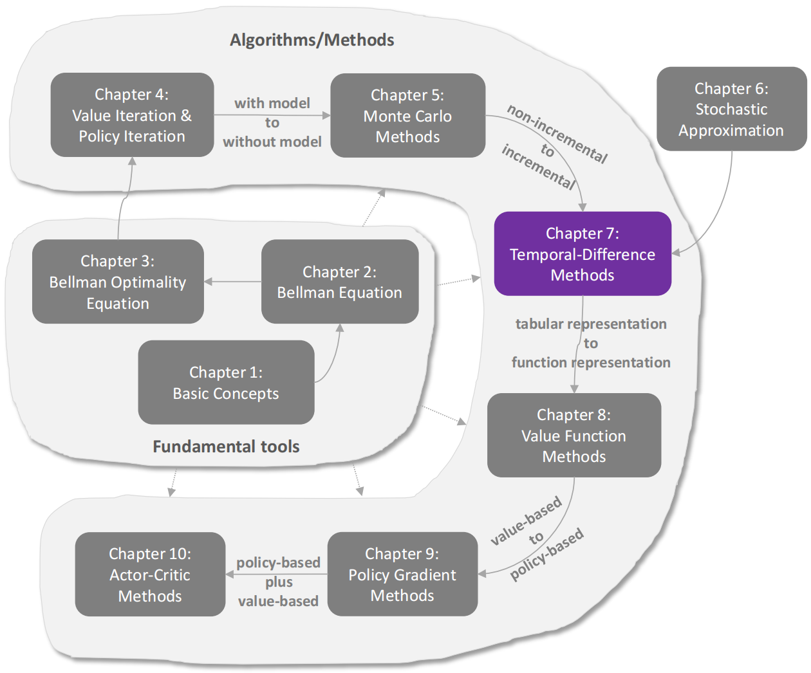

# 时序差分法

本章介绍用于强化学习的时序差分（temporal-difference，TD）方法。

与蒙特卡洛（Monte Carlo，MC）学习类似，TD 学习同样属于无模型（model-free）方法，但由于其具有**增量式**（incremental）的形式，因此具有一些优势。

有了第 6 章的准备，读者在看到 TD 学习算法时将不会感到陌生。事实上，TD 学习算法可以看作是用于求解 Bellman 方程或 Bellman 最优方程的特殊随机算法。

由于本章会介绍多个 TD 算法，因此我们首先对这些算法进行概述，并说明它们之间的关系。

1. 第 7.1 节介绍最基本的 TD 算法，它能够估计**给定策略的状态价值（state value）**。

   在学习其他 TD 算法之前，理解这一基础算法非常重要。

2. 第 7.2 节介绍 Sarsa 算法，它能够估计**给定策略的动作价值（action value）**。

   该算法可以与策略改进步骤结合，从而寻找最优策略。

   Sarsa 算法可以很容易地由第 7.1 节中的 TD 算法得到，只需要将状态价值估计替换为动作价值估计即可。

3. 第 7.3 节介绍 n-step Sarsa 算法，它是 Sarsa 算法的推广。

   后文将会说明：

   - Sarsa
   - MC 学习

   都是 n-step Sarsa 的特殊情况。

4. 第 7.4 节介绍 Q-learning 算法，它是最经典的强化学习算法之一。

   其他 TD 算法旨在求解某个给定策略对应的 Bellman 方程，而 Q-learning 则直接求解 Bellman 最优方程，以获得最优策略。

5. 第 7.5 节对本章介绍的 TD 算法进行比较，并给出统一的观点。

## 回顾基础

- 状态价值$v_\pi(s)$：$v_{\pi}(s)=\sum_{a\in\mathcal{A}}\pi(a|s)\left[\sum_{r\in\mathcal{R}}p(r|s,a)r+\gamma\sum_{s^{\prime}\in\mathcal{S}}p(s^{\prime}|s,a)v_{\pi}(s^{\prime})\right]$

- 动作价值$q_\pi(s,a)$：$\begin{aligned}q_\pi(s,a)=\sum_{r\in\mathcal{R}}p(r|s,a)r+\gamma\sum_{s^{\prime}\in\mathcal{S}}p(s^{\prime}|s,a)v_\pi(s^{\prime}).\end{aligned}$

## 状态价值的 TD 学习

TD 学习（temporal-difference learning）通常泛指一大类强化学习算法。

例如，本章中介绍的所有算法都属于 TD 学习的范畴。

然而，本节中的 “TD learning” 特指一种经典的、用于估计状态价值（state value）的算法。

### 算法描述

- 给定一个 策略$\pi$，我们的目标是对 所有状态$s\in S$ 估计其 状态价值$v_\pi(s)$。

  假设我们已经获得了一些按照 策略$\pi$ 生成的经验样本$(s_0,r_1,s_1,\dots,s_t,r_{t+1},s_{t+1},\dots)$。这里，$t$ 表示时间步（time step）。下面的 TD 算法可以利用这些样本来估计状态价值：
  \[
  \underbrace{v_{t+1}(s_t)}_{\text{更新后的状态价值估计}}=\underbrace{v_t(s_t)}_{\text{当前状态价值估计}}-\underbrace{\alpha_t(s_t)}_{\text{学习率}}\left[\underbrace{v_t(s_t)}_{\text{当前状态价值估计}}-\left(\underbrace{r_{t+1}}_{\text{即时奖励}}+\underbrace{\gamma}_{\text{折扣因子}}\underbrace{v_t(s_{t+1})}_{\text{下一状态的价值估计}}\right)\right] \tag{7.1}
  \label{td_value_update}
  \]
  
  但是我们注意到该公式在 时间步$t$ 下只更新了 状态$s_t$的价值$v_t(s_t)$，但是没有更新别的状态的价值，而在该算法中其他状态在时间步$t$的价值保持不变，即：
  $$
  v_{t+1}(s) = v_t(s), \qquad \forall s \neq s_t
  \tag{7.2}
  \label{td_state_invariance}
  $$
  其中：

  - 时间步 $t=0,1,2,\dots$

  - $v_t(s_t)$ 表示 在时间 $t$ 时，对 $v_\pi(s_t)$ 的估计；
  - $\alpha_t(s_t)$ 表示 时间 $t$ 时状态 $s_t$ 的学习率（learning rate）。
  
- 需要注意的是：

  在时间 $t$ 时，只有 被访问到的状态$s_t$ 的价值会被更新。

  对于所有 未被访问到的状态$s\neq s_t$ ，其价值保持不变，如 式$\eqref{td_state_invariance}$ 所示。

  **为了简洁起见，式$\eqref{td_state_invariance}$ 经常被省略**，但需要牢记这一点，因为如果没有这个式子，算法在数学上是不完整的。

- 举个例子

  - 现在机器人经历了以下过程：
    $$
    (s_0,r_1=-1,s_1,r_2=-1,s_2,r_3=10,s_3)
    $$

  - 设 每个状态的初始状态价值$v_0(s)$都为0，假设 \[ \alpha=0.5,\gamma=0.9 \]

  - 使用 TD算法 来求得每个状态的状态价值

    > [!NOTE]
    >
    > 因为某一个 时间步$t$ 只更新 状态$s_t$的状态价值，而没有更新其他状态的状态价值，
    >
    > 所以此时其他状态的状态价值保持不变：$v_t(s_{t+1}) = v_{t-1}(s_{t+1})$

    - 对于时间步$t=0$：
      $$
      \begin{aligned}
      v_1(s_0) 
      &= v_0(s_0)-\alpha_0(s_0) \left[ v_0(s_0)-(r_1+\gamma v_0(s_1)) \right]
      \\
      &= 0-0.5*[0-(-1+0.9*0)]
      \\
      &= -0.5
      \end{aligned}
      $$
      在 $t=0$时更新了 $s_0$的状态价值，而对于$s_1,s_2,s_3$都没有更新，所以：

      | 状态    | 初始价值 \(v_0\) | 第一步后 \(v_1\) |
      | ------- | ---------------- | ---------------- |
      | \(s_0\) | 0                | -0.5             |
      | \(s_1\) | 0                | 0                |
      | \(s_2\) | 0                | 0                |
      | \(s_3\) | 0                | 0                |

    - 对于时间步$t=1$：
      \[
      \begin{aligned} v_2(s_1) &=v_1(s_1)-\alpha_1(s_1) \left[v_1(s_1)-(r_2+\gamma v_1(s_2))\right]\\ &=0-0.5\times[0-(-1+0.9\times0)]\\ &=\boxed{-0.5} \end{aligned}
      \]

      | 状态    | 初始价值 \(v_0\) | 第一步后 \(v_1\) | 第二步后 \(v_2\) |
      | ------- | ---------------- | ---------------- | ---------------- |
      | \(s_0\) | 0                | -0.5             | -0.5             |
      | \(s_1\) | 0                | 0                | -0.5             |
      | \(s_2\) | 0                | 0                | 0                |
      | \(s_3\) | 0                | 0                | 0                |

    - 对于时间步$t=2$：
      $$
      \begin{aligned}
      v_3(s_2) 
      &= v_2(s_2)-\alpha_2(s_2) \left[ v_2(s_2)-(r_3+\gamma v_2(s_3)) \right]
      \\
      &= 0-0.5*[0-(10+0.9*0)]
      \\
      &= 5
      \end{aligned}
      $$

      | 状态    | 初始价值 \(v_0\) | 第一步后 \(v_1\) | 第二步后 \(v_2\) | 第三步后 \(v_3\) |
      | ------- | ---------------- | ---------------- | ---------------- | ---------------- |
      | \(s_0\) | 0                | -0.5             | -0.5             | -0.5             |
      | \(s_1\) | 0                | 0                | -0.5             | -0.5             |
      | \(s_2\) | 0                | 0                | 0                | 5                |
      | \(s_3\) | 0                | 0                | 0                | 0                |

  - 因为在这个例子中，每个状态都只被访问了一次，所以每个状态的价值也只更新了一次。

    虽然展示了 TD 算法在每个时间步进行更新的过程，但没有体现出**多次访问同一个状态**、**反复更新其状态价值**，并**使价值估计逐渐趋于真实值**的迭代过程。

    因此，该例主要是为了帮助理解 TD 算法的基本更新机制，而不是展示 TD 算法完整的迭代学习过程。

### 算法推导

#### TD算法为什么是这样设计的？

TD 学习要解决的问题是：**给定策略 $\pi$，只通过与环境交互得到的经验，估计各个状态的价值。**

它的设计思路可以概括为：

> 每走一步，就用“这一步实际拿到的奖励 + 对剩余回报的估计”，构造一个学习目标，再让当前状态的价值估计向这个目标靠近一点。

要理解这句话，需要依次回答三个问题：

1. 为什么可以用“即时奖励 + 下一状态的价值”作为依据？
2. 下一状态的真实价值也不知道，怎么办？
3. 有了目标后，为什么采用这样的更新公式？

下面用 $v_\pi(s)$ 表示**真实价值**，用 $v_t(s)$ 表示**时间步 $t$ 时的价值估计**。

##### 1. 我们真正想估计的是什么？

- 当前我们研究的是状态价值的TD学习，状态价值的定义是：

  $$
  \underbrace{
    v_{{\pi}}
    \left({s}\right)
    }_{\text{状态价值}}
    =
    {
    \mathbb{E}_{{\pi}}}
    \left[
    \underbrace{R_{t+1}}_{\text{下一时刻获得的奖励}}
    +
    \underbrace{\gamma}_{\text{折扣因子}}
    \underbrace{G_{t+1}}_{\text{从时刻 $t+1$ 开始的回报}}
    \;\middle|\;
    \underbrace{S_t}_{\text{时刻 $t$ 的状态}}
    =
    \underbrace{s}_{\text{给定的当前状态}}
    \right],
    \quad
    \underbrace{s\in\mathcal{S}}_{\text{$s$ 属于状态空间}}
    \tag{7.3}
    \label{state_value_definition}
  $$
  其中，回报为

  $$
  G_t=R_{t+1}+\gamma R_{t+2}+\gamma^2R_{t+3}+\cdots
  =R_{t+1}+\gamma G_{t+1}.
  $$

  也就是说，$v_\pi(s)$ 是：**从状态 $s$ 出发，遵循策略 $\pi$ 时，未来累计折扣回报的平均水平。**

  例如，$v_t(A)=5$ 表示当前估计：“从 A 出发，未来累计折扣回报平均是 5。”

  > [!NOTE]
  >
  > 要区分以下三个量：
  >
  > | 量         | 含义                                         |
  > | ---------- | -------------------------------------------- |
  > | $G_t$      | 回报随机变量；一条实际轨迹会给出它的一次取值 |
  > | $v_\pi(s)$ | 从状态 $s$ 出发的回报的条件期望，是真实价值  |
  > | $v_t(s)$   | 当前对真实价值的估计，会随学习而变化         |
  >
  > 它们通常不相等。尤其是，状态价值不能直接等同于某一次经历的实际回报。

- **从定义出发，最直接的估计办法是什么？**

  既然 $v_\pi(s)=\mathbb E_\pi[G_t\mid S_t=s]$，一个自然的办法就是：按照策略 $\pi$ 行动，收集从状态 $s$ 出发的实际回报，再对它们求平均。

  对于在时刻 $T$ 终止的一幕，从时刻 $t$ 开始的回报为：

  $$
  G_t
  =
  R_{t+1}+\gamma R_{t+2}+\cdots+\gamma^{T-t-1}R_T.
  $$

  如果要用这一次经历中**完整的实际回报**作为学习目标，就需要等到这一幕结束，才知道后面的全部奖励，进而算出 $G_t$。这就是这里考虑的蒙特卡洛（MC）价值估计的基本思路。

  > [!IMPORTANT]
  >
  > 一幕结束后，可以算出这一次经历的回报 $G_t$，但通常还不能直接得到真实价值 $v_\pi(s)$。
  >
  > 因为 $v_\pi(s)$ 是条件期望，需要通过多次回报样本来估计。状态价值的定义本身也没有要求必须等待整幕结束；“等待整幕结束”来自选择完整实际回报作为学习目标的做法。

- **等待完整回报，会带来哪些限制？**
  1. **更新需要等待，长幕中的学习反馈会延迟。** 例如，智能体在第 1 步访问状态 A，但整幕到第 1000 步才结束。若用完整回报更新 A，就必须等到第 1000 步之后；中途虽然已经观察到奖励和状态变化，却还不能形成这一次完整回报的更新目标。

  2. **没有终止时刻时，不能在有限时间内观察到完整回报。** 在持续性任务中，轨迹可能一直延续。即使折扣回报的无限和存在，也无法等待“整条轨迹结束”后再计算它。可以考虑截断回报等办法，但那已经改变了原先使用完整实际回报的目标。

  3. **完整回报包含之后整段经历的随机性。** 即使从同一个状态出发，不同轨迹的奖励和后续状态也可能不同，得到的 $G_t$ 因而可能相差较大。通过多次采样求平均可以减弱这种波动，但可能需要较多经验；不能把某一幕的结果直接当作该状态的真实价值。

- **因此，我们希望每获得一步经验，就能推进价值估计。**

  也就是说，希望实现：

  > 不必等到后面的全部奖励都出现，就能利用刚获得的奖励和下一状态的信息，先修正当前状态的价值估计；随着经验增加，再不断改进。

  这里确实用到了“迭代逼近”的思想，不过还要进一步区分：**MC 也可以迭代更新；TD 的关键在于，不等待完整回报，而用当前估计补上尚未观察到的未来回报。**

  例如，收集到状态 $s$ 的第 $n$ 个完整回报样本 $G^{(n)}(s)$ 后，MC 的样本均值也可以增量更新：

  $$
  \hat v_n(s)
  =
  \hat v_{n-1}(s)
  +
  \frac{1}{n}\left[G^{(n)}(s)-\hat v_{n-1}(s)\right].
  $$

  这里的 $n$ 是已收集的回报样本数，不是环境时间步。这个公式不必每次重新累加所有历史回报，但**每个新的完整回报样本仍然需要等待一幕结束后才能得到**。

  TD 则进一步提出：既然

  $$
  G_t=R_{t+1}+\gamma G_{t+1},
  $$

  走一步后，$R_{t+1}$ 已经观察到了，而 $G_{t+1}$ 还没有完整观察到。那么，能否先用下一状态的价值估计 $v_t(S_{t+1})$ 来代替这段尚未观察完的回报，构造一个可以立即使用的目标？

  $$
  \underbrace{R_{t+1}+\gamma G_{t+1}}_{\text{完整实际回报，需要等待}}
  \quad\longrightarrow\quad
  \underbrace{R_{t+1}+\gamma v_t(S_{t+1})}_{\text{一步之后即可构造的估计目标}}.
  $$

  接下来要解释的就是：**为什么下一状态的价值可以承担这个作用，以及怎样根据这个目标逐步更新估计。**

##### 2. 为什么“即时奖励 + 下一状态价值”能作为依据？

从当前状态出发，未来回报可以拆成两部分：

$$
\underbrace{G_t}_{\text{从现在开始的回报}}
=
\underbrace{R_{t+1}}_{\text{这一步的奖励}}
+
\gamma\underbrace{G_{t+1}}_{\text{从下一时刻开始的回报}}.
$$

当智能体到达下一状态 $s'$ 后，未来仍然遵循策略 $\pi$。根据状态价值的定义：

$$
v_\pi(s')
=
\mathbb E_\pi[G_{t+1}\mid S_{t+1}=s'].
$$

这里的含义是：**从下一状态开始，未来回报的平均水平，就是下一状态的价值。**

接下来，需要解释为什么

$$
\mathbb E_\pi[G_{t+1}\mid S_t=s]
=
\mathbb E_\pi[v_\pi(S_{t+1})\mid S_t=s].
$$

下面把这个等式从条件期望的定义开始逐步展开。

**先明确符号。**

- $S_t$、$S_{t+1}$ 是状态随机变量，$s$、$s'$ 是具体状态。
- $G_{t+1}$ 是从下一时刻开始的回报随机变量，$g$ 表示它的一种可能取值。
- 固定 $S_t=s$，即下面始终讨论“当前已经处于状态 $s$”的情形。

为了把求和过程写清楚，下面以状态和回报都取离散值、回报可积的情形为例。如果回报具有连续分布，相关求和需换成积分；全期望公式的结论仍成立。以下只对条件概率有定义的取值展开。

定义一个关于下一状态的函数：

$$
\boxed{
\begin{aligned}
f_s(s')
&=\mathbb E_\pi[G_{t+1}\mid S_{t+1}=s',S_t=s],\\[6pt]
f_s(S_{t+1})
&=\mathbb E_\pi[G_{t+1}\mid S_{t+1},S_t=s].
\end{aligned}
}
$$

这里，$f_s(s')$ 是指定下一状态为 $s'$ 后得到的一个数；$f_s(S_{t+1})$ 则把随机变量 $S_{t+1}$ 作为函数的输入，因此本身也是随机变量。下标 $s$ 表示定义这个函数时，已经固定当前状态为 $s$。

**完整推导如下：**

$$
\begin{aligned}
&\mathbb E_\pi[G_{t+1}\mid S_t=s]\\[8pt]
&\overset{\text{① 条件期望的定义}}{=}
\sum_g g\,P_\pi(G_{t+1}=g\mid S_t=s)\\[10pt]
&\overset{\text{② 按下一状态展开概率}}{=}
\sum_g g\sum_{s'}
P_\pi(G_{t+1}=g,S_{t+1}=s'\mid S_t=s)\\[10pt]
&\overset{\text{③ 条件概率的乘法公式}}{=}
\sum_g g\sum_{s'}
P_\pi(G_{t+1}=g\mid S_{t+1}=s',S_t=s)
P_\pi(S_{t+1}=s'\mid S_t=s)\\[10pt]
&\overset{\text{④ 交换求和顺序}}{=}
\sum_{s'}P_\pi(S_{t+1}=s'\mid S_t=s)
\sum_g g\,P_\pi(G_{t+1}=g\mid S_{t+1}=s',S_t=s)\\[10pt]
&\overset{\text{⑤ 识别内层条件期望}}{=}
\sum_{s'}P_\pi(S_{t+1}=s'\mid S_t=s)\,
\mathbb E_\pi[G_{t+1}\mid S_{t+1}=s',S_t=s]\\[10pt]
&\overset{\text{⑥ 代入 }f_s(s')\text{ 的定义}}{=}
\sum_{s'}P_\pi(S_{t+1}=s'\mid S_t=s)\,f_s(s')\\[10pt]
&\overset{\text{⑦ 随机变量函数的条件期望公式}}{=}
\mathbb E_\pi[f_s(S_{t+1})\mid S_t=s]\\[10pt]
&\overset{\text{⑧ 代入 }f_s(S_{t+1})\text{ 的定义}}{=}
\mathbb E_\pi\left[
\mathbb E_\pi[G_{t+1}\mid S_{t+1},S_t=s]
\mid S_t=s
\right]\\[10pt]
&\overset{\text{⑨ 马尔可夫性质与固定策略}}{=}
\mathbb E_\pi\left[
\mathbb E_\pi[G_{t+1}\mid S_{t+1}]
\mid S_t=s
\right]\\[10pt]
&\overset{\text{⑩ 状态价值的定义}}{=}
\mathbb E_\pi[v_\pi(S_{t+1})\mid S_t=s].
\end{aligned}
$$

**下面解释每一步在做什么。**

**第①步：把“期望”写成“取值 × 概率”的求和。**

对于离散随机变量 $X$：

$$
\mathbb E[X\mid Y=y]
=
\sum_x x\,P(X=x\mid Y=y).
$$

令 $X=G_{t+1}$、$Y=S_t$、$y=s$，就得到第①步。

**第②步：按照下一状态，对回报出现的概率分类。**

当前处于 $s$ 时，回报 $G_{t+1}=g$ 可能伴随不同的下一状态。把这些互斥情形的概率相加：

$$
P_\pi(G_{t+1}=g\mid S_t=s)
=
\sum_{s'}P_\pi(G_{t+1}=g,S_{t+1}=s'\mid S_t=s).
$$

这里先保留联合概率，还没有用到马尔可夫性质。

**第③步：把联合概率拆成“到达该状态的概率 × 到达后取得该回报的条件概率”。**

条件概率的乘法公式为：

$$
P(A,B\mid C)=P(A\mid B,C)P(B\mid C).
$$

这里分别取

$$
A=\{G_{t+1}=g\},\qquad
B=\{S_{t+1}=s'\},\qquad
C=\{S_t=s\}.
$$

这一步只是概率公式，不要求回报与下一状态相互独立。

**第④步：先按下一状态分类，再在每一类中计算回报的平均值。**

原来是先对 $g$ 求和，再对 $s'$ 求和；现在交换顺序。由于 $P_\pi(S_{t+1}=s'\mid S_t=s)$ 与 $g$ 无关，可以移到内层对 $g$ 的求和之外。

这里假设回报可积，以保证交换求和合法。

**第⑤步：把内层求和重新识别为条件期望。**

固定下一状态 $s'$ 后：

$$
\sum_g g\,P_\pi(G_{t+1}=g\mid S_{t+1}=s',S_t=s)
=
\mathbb E_\pi[G_{t+1}\mid S_{t+1}=s',S_t=s].
$$

它表示：“已知当前状态为 $s$、下一状态为 $s'$ 时，之后回报的平均值。”

**第⑥步：用前面定义的函数 $f_s(s')$ 代替这段条件期望。**

$$
\mathbb E_\pi[G_{t+1}\mid S_{t+1}=s',S_t=s]=f_s(s').
$$

到这里，整个表达式变成了：

$$
\sum_{s'}\underbrace{P_\pi(S_{t+1}=s'\mid S_t=s)}_{\text{到达下一状态 }s'\text{ 的概率}}
\underbrace{f_s(s')}_{\text{到达 }s'\text{ 后，未来回报的条件期望}}.
$$

**第⑦步：用“随机变量函数的条件期望公式”把求和写回期望。**

这个公式是：

$$
\mathbb E[f(X)\mid Y=y]
=
\sum_x f(x)P(X=x\mid Y=y).
$$

在这里，令

$$
f=f_s,\qquad X=S_{t+1},\qquad Y=S_t,\qquad y=s,
$$

就得到：

$$
\mathbb E_\pi[f_s(S_{t+1})\mid S_t=s]
=
\sum_{s'}f_s(s')P_\pi(S_{t+1}=s'\mid S_t=s).
$$

因此，第⑦步只是把同一个加权平均从求和形式改写为期望形式。

**第⑧步：把 $f_s(S_{t+1})$ 换回它的定义。**

$$
f_s(S_{t+1})
=
\mathbb E_\pi[G_{t+1}\mid S_{t+1},S_t=s].
$$

因此得到两层期望：

$$
\mathbb E_\pi\left[
\underbrace{\mathbb E_\pi[G_{t+1}\mid S_{t+1},S_t=s]}_{\text{先固定下一状态，求未来回报的条件期望}}
\mid S_t=s
\right].
$$

外层期望再按照各个下一状态出现的概率，对内层结果求平均。第①至第⑧步合起来，就是这里使用的**条件全期望公式**的展开。

**第⑨步：利用马尔可夫性质，去掉内层条件中的前一个状态。**

在马尔可夫环境和固定的马尔可夫策略下，给定下一状态 $S_{t+1}$ 后，之后的状态、动作、奖励的条件分布就不再依赖前一个状态 $S_t$。因此：

$$
\mathbb E_\pi[G_{t+1}\mid S_{t+1},S_t=s]
=
\mathbb E_\pi[G_{t+1}\mid S_{t+1}].
$$

注意：**去掉的是内层期望中的 $S_t=s$，外层期望仍然保留这个条件。** 因为当前处于哪个状态，仍然会影响下一状态出现的概率。

**第⑩步：用状态价值代替内层期望。**

根据状态价值的定义，对任意可能到达的状态 $s'$：

$$
v_\pi(s')=\mathbb E_\pi[G_{t+1}\mid S_{t+1}=s'].
$$

把具体的 $s'$ 换成随机的下一状态 $S_{t+1}$，就有：

$$
\mathbb E_\pi[G_{t+1}\mid S_{t+1}]
=
v_\pi(S_{t+1}).
$$

于是得到最终结果：

$$
\boxed{
\mathbb E_\pi[G_{t+1}\mid S_t=s]
=
\mathbb E_\pi[v_\pi(S_{t+1})\mid S_t=s].
}
$$

它表达的是：**当前处于状态 $s$ 时，未来回报的平均值，可以先按下一状态分类，求出各类的未来回报平均值，再按到达各个下一状态的概率加权。**

将这个结果代入当前状态价值的定义：

$$
\begin{aligned}
v_\pi(s)
&=\mathbb E_\pi[G_t\mid S_t=s]\\
&=\mathbb E_\pi[R_{t+1}+\gamma G_{t+1}\mid S_t=s]\\
&=\mathbb E_\pi[R_{t+1}\mid S_t=s]
+\gamma\mathbb E_\pi[G_{t+1}\mid S_t=s]\\
&=\mathbb E_\pi[R_{t+1}\mid S_t=s]
+\gamma\mathbb E_\pi[v_\pi(S_{t+1})\mid S_t=s].
\end{aligned}
$$

合并两个期望，得到**贝尔曼期望方程**：

$$
\boxed{
v_\pi(s)
=
\mathbb E_\pi\left[
R_{t+1}+\gamma v_\pi(S_{t+1})
\mid S_t=s
\right].
}
\tag{7.4}
\label{bellman_expectation}
$$

它说明，正确的价值应满足：

> 当前状态的价值 = “即时奖励 + 折扣后的下一状态价值”的平均。

注意，这里替换的是**期望中的未来回报**。并没有断言每次实际经历中都有 $G_{t+1}=v_\pi(S_{t+1})$。

##### 3. 怎样把贝尔曼方程变成可以学习的目标？

贝尔曼方程给出了真实价值应满足的关系，但实际学习时有两个困难：

- **不知道下一状态的真实价值 $v_\pi(s')$**：它也需要学习。
- **不能直接算出期望**：环境的奖励、转移概率可能未知，我们只能观察实际经历。

TD 分别采用以下办法。

**第一，用当前估计 $v_t(s')$ 代替未知的真实价值 $v_\pi(s')$。**

这样，对于一份给定的价值估计 $v_t$，可以考虑下面的平均目标：

$$
\mathbb E_\pi\left[
R_{t+1}+\gamma v_t(S_{t+1})
\mid S_t=s
\right].
$$

**第二，用一次实际转移构造这个平均目标的样本。**

当观察到经验

$$
s_t\xrightarrow{r_{t+1}}s_{t+1}
$$

时，就能计算：

$$
\boxed{
\bar v_t=r_{t+1}+\gamma v_t(s_{t+1})
}
$$

这就是 **TD 目标**。

它由两部分组成：

$$
\underbrace{r_{t+1}}_{\text{这一步已经观察到的奖励}}
+
\gamma\underbrace{v_t(s_{t+1})}_{\text{对之后回报的估计}}.
$$

因此，只走一步就能形成目标，不必等到整幕结束、拿到完整回报 $G_t$ 后才更新。

> [!IMPORTANT]
>
> TD 目标包含对未来的估计，所以它可能有偏差。它是相对于当前价值估计构造的一步样本目标，不能直接当作真实价值。
>
> 当整份价值估计已经正确，即 $v_t=v_\pi$ 时，根据贝尔曼方程，在给定当前状态后，这个目标的期望恰好等于该状态的真实价值。

##### 4. 为什么采用“旧估计 + 学习率 × 差值”？

有了 TD 目标后，我们希望当前估计向目标靠近。但一次目标会受到采样随机性和下一状态估计误差的影响，因此通常只采纳一部分：

$$
\boxed{
\text{新估计}
=
\text{旧估计}
+
\text{学习率}\times(\text{目标}-\text{旧估计})
}
$$

代入 TD 目标：

$$
v_{t+1}(s_t)
=
v_t(s_t)
+
\alpha_t(s_t)
\left[
r_{t+1}+\gamma v_t(s_{t+1})-v_t(s_t)
\right].
$$

它也可以写成加权平均的形式：

$$
v_{t+1}(s_t)
=
[1-\alpha_t(s_t)]v_t(s_t)
+
\alpha_t(s_t)\bar v_t.
$$

当 $0<\alpha_t(s_t)\leq1$ 时，学习率决定采纳多少新目标的信息：

- $\alpha=1$：直接用本次目标替换旧估计。
- $0<\alpha<1$：保留一部分旧估计，向本次目标靠近。

把括号内的差值反过来，再把外面的加号改为减号，就得到前面的式 (7.1)：

$$
v_{t+1}(s_t)
=
v_t(s_t)
-
\alpha_t(s_t)
\left[
v_t(s_t)-\left(r_{t+1}+\gamma v_t(s_{t+1})\right)
\right].
$$

其他状态本步保持不变：$v_{t+1}(s)=v_t(s)$，其中 $s\neq s_t$。

##### 5. 用一个数值例子理解更新方向

假设当前估计：

$$
v_t(A)=5,\qquad v_t(B)=10,\qquad \gamma=0.9.
$$

现在观察到：

$$
A\xrightarrow{2}B.
$$

那么，对 A 构造的 TD 目标为：

$$
\bar v_t=2+0.9\times10=11.
$$

这个目标表达的是：“已经拿到 2；对之后回报的估计折扣后是 9；合起来是 11。”

原先估计为 5，本次目标为 11，所以这次更新应当把 A 的估计调高。若 $\alpha=0.1$：

$$
v_{t+1}(A)=5+0.1(11-5)=5.6.
$$

若目标低于旧估计，同一个公式就会把估计调低。**更新方向由目标与旧估计的差决定。**

##### 6. 下一状态的估计也不准，为什么还能学对？

“用当前估计帮助更新估计”称为**自举（bootstrapping）**。

理解自举的关键是：**这些估计会受到实际奖励的不断校正，奖励的信息会通过状态之间的转移逐步传播。**

考虑一个确定性的例子，每一幕都经历：

$$
A\xrightarrow{0}B\xrightarrow{10}\text{终止}.
$$

设 $\gamma=0.9$，初始估计 $v_0(A)=v_0(B)=0$，终止状态的价值固定为 0。为了看清传播过程，这个确定性例子取 $\alpha=1$。

| 过程 | 本次更新 | 更新后的 $v(A)$ | 更新后的 $v(B)$ |
| --- | --- | --- | --- |
| 第一幕：A → B | A 的目标为 $0+0.9\times0=0$ | 0 | 0 |
| 第一幕：B → 终止 | B 的目标为 $10+0.9\times0=10$ | 0 | 10 |
| 第二幕：A → B | A 的目标为 $0+0.9\times10=9$ | 9 | 10 |
| 第二幕：B → 终止 | B 的目标仍为 10 | 9 | 10 |

第一幕结束后，B 已经从实际奖励中学到自己的价值为 10；第二幕再次访问 A 时，A 就可以利用 B 改进后的估计，学到自己的价值为 9。

注意，第一幕里 B 更新成 10 时，A 已经完成了那一步更新，所以要等到再次访问 A，才能把这条信息用于 A 的更新。

这个例子展示了奖励信息的传播方式。一般的随机环境中，某次更新不一定更接近真实价值；表格型 TD 的收敛还需要固定策略、合适的环境条件、充分的状态访问，以及满足要求的学习率。后面的收敛性分析会进一步说明这些条件。

##### 7. 这与“求解贝尔曼方程”有什么关系？

- 一个状态的价值，应该等于从这个状态出发，未来能够获得的所有奖励的折扣总和的期望。

- TD 的每次更新都在尝试减小 **当前状态的价值估计**与**本次TD目标不相等** 的不一致：

  $$
  \underbrace{v_t(s_t)}_{\text{当前估计}}
  -
  \underbrace{\left[r_{t+1}+\gamma v_t(s_{t+1})\right]}_{\text{本次样本目标}}.
  $$

  对同一状态反复采样，可以逐步平均采样噪声的影响（根据大数定律，多次独立采样后，噪声的平均值会趋于其期望，也就是零）；同时，下一状态的价值估计也在学习，使目标随之调整。满足收敛条件时，整份价值估计最终趋于贝尔曼方程的解 $v_\pi$。

  因此，TD 的设计包含三个相互配合的选择：

  | 设计                                         | 作用                                                 |
  | -------------------------------------------- | ---------------------------------------------------- |
  | 用 $v_t(s_{t+1})$ 估计后续回报               | 不必等待完整回报，能够自举                           |
  | 用实际转移构造 $r_{t+1}+\gamma v_t(s_{t+1})$ | 不必知道环境的奖励和转移概率                         |
  | 用学习率控制向目标靠近的幅度                 | 逐步吸收经验，并在合适的步长条件下减弱采样噪声的影响 |

下一节将把这里的“根据样本差值逐步修正”，写成 Robbins–Monro 随机逼近的形式。

#### TD 算法的推导过程

> 接下来，我们将说明如何通过应用 Robbins–Monro 算法来求解式\(\eqref{bellman_expectation}\)，从而得到式\(\eqref{td_value_update}\)中的 TD 算法。

1. 定义一个 函数$g$ 以将`贝尔曼方程`改写成 `Robbins–Monro 算法`能处理的形式：**求一个函数的零点**。

   - `贝尔曼方程`对状态 \(s_t\) 写作：\[ v_\pi(s_t) = \mathbb E_\pi\left[ R_{t+1}+\gamma v_\pi(S_{t+1}) \mid S_t=s_t \right]. \]

     把右边移到左边，方程成立时两边之差应为零。于是定义\[ g\left(v_\pi(s_t)\right) = v_\pi(s_t) - \mathbb E_\pi\left[ R_{t+1}+\gamma v_\pi(S_{t+1}) \mid S_t=s_t \right], \]

     贝尔曼方程就等价于\[ g\left(v_\pi(s_t)\right)=0. \]

2. **我们的目标是求解上述方程，从而通过 Robbins–Monro 算法得到状态 \(s_t\) 的价值 \(v_\pi(s_t)\)**

   - 由于我们可以获得 \(r_{t+1}\) 和 \(s_{t+1}\)，它们分别是随机变量 \(R_{t+1}\) 和 \(S_{t+1}\) 的样本，因此，我们能够获得的 \(g(v_\pi(s_t))\) 的带噪观测值为：
     $$
     \begin{aligned} \tilde{g}\left(v_\pi(s_t)\right) &= v_\pi(s_t) - \left[ r_{t+1}+\gamma v_\pi(s_{t+1}) \right]\\[6pt] &= \underbrace{ \left\{ v_\pi(s_t) - \mathbb{E}_\pi \left[ R_{t+1}+\gamma v_\pi(S_{t+1}) \mid S_t=s_t \right] \right\} }_{g(v_\pi(s_t))} \\[6pt] &\quad+ \underbrace{ \left\{ \mathbb{E}_\pi \left[ R_{t+1}+\gamma v_\pi(S_{t+1}) \mid S_t=s_t \right] - \left[ r_{t+1}+\gamma v_\pi(s_{t+1}) \right] \right\} }_{\eta_t}. \end{aligned}
     $$
     其中：

     - \(\eta_t\) 定义为 **带噪观测值\(\tilde g\)** 与 **理想值\(g\)** 之间的差：\[ \eta_t \equiv \tilde g(v_\pi(s_t))-g(v_\pi(s_t)). \]

   - 因此，根据 Robbins–Monro 的 **随机求根更新算法**，

     为了求解方程 \(g(v_\pi(s_t))=0\)，我们可以采用如下更新规则：如果要找 \(g(x)=0\) 的根，就从当前猜测 \(x_t\) 出发，根据一次带噪观测 \(\tilde g(x_t)\) 调整它：
     $$
     x_{t+1}=x_t-\alpha_t\tilde g(x_t).
     $$
     这儿要找的根是状态 \(s_t\) 的真实价值 \(v_\pi(s_t)\)，所以把当前猜测 \(x_t\) 换成它的估计 \(v_t(s_t)\)：
     \[
     v_{t+1}(s_t) = v_t(s_t)-\alpha_t(s_t)\tilde g\bigl(v_t(s_t)\bigr).
     \]
     再把带噪观测的形式代入，就得到：
     $$
     \begin{aligned} v_{t+1}(s_t) &= v_t(s_t) - \alpha_t(s_t) \tilde{g}\left(v_t(s_t)\right)\\[6pt] &= v_t(s_t) - \alpha_t(s_t) \left\{ v_t(s_t) - \left[ r_{t+1}+\gamma v_\pi(s_{t+1}) \right] \right\}. \end{aligned} \tag{7.5}\label{robbins_monro_update}
     $$
     其中：

     - \(v_t(s_t)\) 表示在时间步 \(t\) 对状态 \(s_t\) 的价值 \(v_\pi(s_t)\) 的估计
     - \(\alpha_t(s_t)\) 表示相应的学习率。

     式\(\eqref{robbins_monro_update}\)的形式与式\(\eqref{td_value_update}\)中的 TD 算法非常相似。**二者唯一的区别在于：式\(\eqref{robbins_monro_update}\)右侧使用的是 \(v_\pi(s_{t+1})\)，而式\(\eqref{td_value_update}\)使用的是 \(v_t(s_{t+1})\)。**

     这是因为，式\(\eqref{robbins_monro_update}\)是在假设其他状态的价值都已经已知的情况下，专门用于估计状态 \(s_t\) 的价值的。

     但是，如果我们希望估计所有状态的价值，就需要将式\(\eqref{robbins_monro_update}\)右侧的 \(v_\pi(s_{t+1})\) 替换为 \(v_t(s_{t+1})\)。这样一来，式\(\eqref{robbins_monro_update}\)就与式\(\eqref{td_value_update}\)完全一致了。

     然而，这样的替换是否仍然能够保证算法收敛呢？

     答案是肯定的，相关证明将在后面的定理 7.1 中给出。

#### 性质分析

现在我们研究 TD算法 的一些重要性质。

观察 式$\eqref{td_value_update}$ ，我们给该式加上一些注释：
\[
\underbrace{v_{t+1}(s_t)}_{\text{新估计值}}
=
\underbrace{v_t(s_t)}_{\text{当前估计值}}
-\alpha_t(s_t)
\left[
\overbrace{
v_t(s_t)-\underbrace{\left(r_{t+1}+\gamma v_t(s_{t+1})\right)}_{\text{TD 目标}\bar{v}_t}
}^{\text{TD 误差 }\delta_t}
\right]
\tag{7.6}
\]
其中：

- $\bar v_t\triangleq r_{t+1}+\gamma v_t(s_{t+1})$ 称为 **TD 目标（TD target）**

- $\delta_t\triangleq v_t(s_t)-\bar v_t
  =v_t(s_t)-\left(r_{t+1}+\gamma v_t(s_{t+1})\right)$ 称为 **TD 误差（TD error）**

  因此，新的估计 \(v_{t+1}(s_t)\) 是当前估计 \(v_t(s_t)\) 与 TD 误差共同决定的。

##### 怎么理解 TD目标 \(\bar v_t\)

因为算法试图推动 \(v_t(s_t)\) 向目标值 \(\bar v_t\) 靠近。将式 (7.6) 两侧同时减去 \(\bar v_t\)，可得

$$
\begin{aligned}
v_{t+1}(s_t)-\bar v_t
&=v_t(s_t)-\bar v_t-\alpha_t(s_t)[v_t(s_t)-\bar v_t]\\
&=[1-\alpha_t(s_t)][v_t(s_t)-\bar v_t].
\end{aligned}
$$

两侧取绝对值：

$$
|v_{t+1}(s_t)-\bar v_t|=|1-\alpha_t(s_t)|\,|v_t(s_t)-\bar v_t|.
$$

由于 \(\alpha_t(s_t)\) 是较小的正数，因此 \(0<1-\alpha_t(s_t)<1\)，于是

$$
|v_{t+1}(s_t)-\bar v_t|<|v_t(s_t)-\bar v_t|.
$$

**这个不等式说明，新值 \(v_{t+1}(s_t)\) 比旧值 \(v_t(s_t)\) 更接近 \(\bar v_t\)。因此，从数学上说，算法会推动 \(v_t(s_t)\) 朝 \(\bar v_t\) 移动，这就是 \(\bar v_t\) 被称为 TD 目标的原因。**

##### 怎么理解 TD 误差 $\delta_t$

1. `时序差分（TD）`的`差分`指的是：把当前时刻的价值估计，与“这一步实际得到的奖励加上下一时刻的价值估计”作比较：
   $$
   \delta_t=v_t(s_t)-\left(r_{t+1}+\gamma v_t(s_{t+1})\right)
   $$

   它比较的是相邻两个时刻的信息：时刻 $t$ 的估计 $v_t(s_t)$，以及由时刻 $t+1$ 的奖励和价值估计组成的目标。这个差值根据一次经验样本计算，因此每次经历都可能不同。

   如果估计已经准确，也就是 $v_t=v_\pi$，那么在同一个状态 $s_t$ 上反复采样时，TD 误差的平均值为零：

   $$
   \begin{aligned}
   \mathbb E[\delta_t\mid S_t=s_t]
   &=v_\pi(s_t)-\mathbb E_\pi\left[R_{t+1}+\gamma v_\pi(S_{t+1})\mid S_t=s_t\right]\\
   &=0.
   \end{aligned}
   $$

   这是因为贝尔曼期望方程说明，真实价值 $v_\pi(s_t)$ 正好等于下一步奖励与折扣后下一状态价值的条件期望，所以两者相减为零（见式\(\eqref{bellman_expectation}\)）。

   “平均值为零”不代表每次采样的 TD 误差都是零。一次经历可能得到较高或较低的奖励，也可能到达不同的下一状态，因此误差会暂时为正或为负。若当前估计还不准确，这些误差就能帮助算法调整估计。

   从估计的角度看，TD 误差也称为**创新量（innovation）**：它表示这次新观察到的经验与当前估计所预期结果之间的差异。TD 学习利用这份新信息更新价值估计。类似的“新观察减去原先预期”的想法，也出现在卡尔曼滤波等估计方法中 [33, 34]。

   最后，本节的 TD 算法用于估计**给定策略** $\pi$ 的状态价值 $v_\pi$。如果目标是找到最优策略，还需要估计动作价值并进行策略改进；第 7.2 节会介绍相关方法。本节的状态价值 TD 学习是理解后续算法的基础。

2. 公式（7.1）中的 TD 算法只能估计给定策略的状态价值。为了找到最优策略，我们还需要进一步计算动作价值，然后进行策略改进。这部分内容将在第 7.2 节中介绍。尽管如此，本节介绍的 TD 算法仍然是一个非常基础且重要的算法，有助于理解本章中的其他算法。

3. 虽然 TD 学习和蒙特卡洛（MC）学习都属于无模型（model-free）方法，但它们各自有哪些优点和缺点呢？

   | 比较维度 | TD 学习（TD Learning） | 蒙特卡洛学习（MC Learning） |
   | ----------------------------------- | ------------------------------------------------------------ | ------------------------------------------------------------ |
   | **增量性（Incremental）** | TD 学习是一种**增量式学习方法**。每当获得一个经验样本后，就可以立即更新状态价值或动作价值。 | MC 学习是一种**非增量式学习方法**。它必须等待一个完整的幕（episode）采集完毕后才能进行更新，因为它需要计算整个幕的折扣回报。 |
   | **适用任务（Tasks）** | **持续性任务（Continuing tasks）：** 由于 TD 学习具有增量性，因此既可以处理幕式任务，也可以处理持续性任务。持续性任务可能不存在终止状态。 | **幕式任务（Episodic tasks）：** 由于 MC 学习是非增量式的，因此只能处理幕式任务，即任务会在有限步数后终止。 |
   | **自举机制（Bootstrapping）** | TD 学习采用**自举机制**，因为状态价值或动作价值的更新依赖于该价值的先前估计。因此，TD 学习需要预先给出一个初始价值估计。 | **非自举（Non-bootstrapping）：** MC 学习不采用自举机制，因为它可以直接估计状态价值或动作价值，而不需要预先给出初始价值估计。 |
   | **估计方差（Estimation Variance）** | **估计方差较低（Low estimation variance）：** TD 学习的估计方差低于 MC 学习，因为它涉及的随机变量较少。例如，为了估计动作价值 $q_\pi(s_t,a_t)$，Sarsa 只需要涉及以下三个随机变量的样本：$R_{t+1}$、$S_{t+1}$ 和 $A_{t+1}$。 | **估计方差较高（High estimation variance）：** MC 学习涉及的随机变量较多，因此估计方差更高。例如，为了估计 $q_\pi(s_t,a_t)$，需要对以下回报进行采样：$\displaystyle R_{t+1}+\gamma R_{t+2}+\gamma^2R_{t+3}+\cdots$。假设每个幕的长度为 $L$，并且每个状态拥有相同数量的动作，即 $\lvert\mathcal{A}\rvert$，那么在一个软策略（soft policy）下，可能存在的幕数量为 $\lvert\mathcal{A}\rvert^L$。如果仅使用少量幕进行估计，那么估计方差较高也就不足为奇了。 |

   **注：** 表中的 TD 指时序差分（Temporal-Difference），MC 指蒙特卡洛（Monte Carlo）。$\gamma$ 为折扣因子，$R_{t+1}$ 为下一时刻获得的奖励，$S_{t+1}$ 为下一时刻的状态，$A_{t+1}$ 为下一时刻选择的动作。

### 收敛性分析

**定理 7.1（TD 学习的收敛性）。** 给定策略 \(\pi\)，若对所有 \(s\in\mathcal S\)，学习率满足
$$
\sum_t\alpha_t(s)=\infty,\qquad \sum_t\alpha_t^2(s)<\infty,
$$

则根据式 (7.1) 的 TD 算法，当 \(t\to\infty\) 时，对所有 \(s\in\mathcal S\)，\(v_t(s)\) 几乎必然收敛到 \(v_\pi(s)\)。

这两个学习率条件可以这样理解。对于某个固定状态 \(s\)，只在访问到它时才更新它的价值；没有访问时，令 \(\alpha_t(s)=0\)。因此，求和是把训练过程中针对状态 \(s\) 的所有更新步长加起来。

- 条件 \(\sum_t\alpha_t(s)=\infty\) 表示累计更新量不能太小。若某状态只被访问有限次，这个和就只有有限项，条件无法满足；所以每个要估计的状态都必须被访问无限多次。
- 条件 \(\sum_t\alpha_t^2(s)<\infty\) 表示步长要逐渐变小，使后期采样噪声对估计的影响逐渐减弱。

例如，若状态 \(s\) 第 \(n\) 次被访问时使用步长 \(\alpha_n(s)=1/n\)，则步长之和发散，而平方和收敛，满足这两个条件。注意这里的 \(n\) 是状态 \(s\) 被访问的次数，不一定等于全局时间步 \(t\)。

这也说明了探索的作用：学习率条件本身不能让状态自动出现；采样过程必须让每个需要估值的状态都反复出现。对于固定策略的状态价值估计，应保证每个相关状态被无限次访问。`探索性初始状态`或`探索性策略`可以帮助达到这一点，但只能覆盖在该设定下确实可能到达的状态。动作价值控制问题中，通常还要保证相关状态-动作对得到足够访问。

实践中有时使用固定的小学习率 \(\alpha\)。这样每次更新都保留一定幅度，因而平方步长之和会发散，不满足上述定理的条件；在持续有采样噪声时，估计通常会在真实值附近波动，而非保证逐次收敛到真实值。固定步长可能在某些额外假设下有期望或稳态误差方面的结论，但不能仅凭本定理推出“收敛到 \(v_\pi\)”。

## 动作价值的 TD 学习：Sarsa

第 7.1 节介绍的 TD 算法只能估计**状态价值**。本节将介绍另一种 TD 算法，称为 **Sarsa**，它可以直接估计**动作价值**。

估计动作价值非常重要，因为它可以与策略改进步骤相结合，从而学习最优策略。

### 算法描述

给定一个策略 $\pi$，我们的目标是估计动作价值。

假设我们已经获得了一些按照策略 $\pi$ 生成的经验样本：
$$
(s_0,a_0,r_1,s_1,a_1,\ldots,s_t,a_t,r_{t+1},s_{t+1},a_{t+1},\ldots)
$$
我们可以使用下面的 **Sarsa 算法**来估计动作价值：
\[
\underbrace{q_{t+1}(s_t,a_t)}_{\text{更新后的动作价值估计}}=\underbrace{q_t(s_t,a_t)}_{\text{当前动作价值估计}}-\underbrace{\alpha_t(s_t,a_t)}_{\text{学习率}}\left[\underbrace{q_t(s_t,a_t)}_{\text{当前动作价值估计}}-\left(\underbrace{r_{t+1}}_{\text{即时奖励}}+\underbrace{\gamma}_{\text{折扣因子}}\underbrace{q_t(s_{t+1},a_{t+1})}_{\text{下一状态—动作价值估计}}\right)\right]
\tag{7.12}
\]
其中：

对于所有满足 $(s,a)\neq(s_t,a_t)$ 的**状态—动作对**，有
$$
q_{t+1}(s,a)=q_t(s,a).
$$
其中，$t=0,1,2,\ldots$，且 $\alpha_t(s_t,a_t)$ 为学习率。

这里，$q_t(s_t,a_t)$ 是对 $q_\pi(s_t,a_t)$ 的估计。

在时刻 $t$，只有状态—动作对 $(s_t,a_t)$ 所对应的 $q$ 值会被更新，其他状态—动作对的 $q$ 值保持不变。

下面讨论 Sarsa 算法的一些重要性质。

1. 为什么这个算法被称为 Sarsa？

   这是因为算法的每次迭代都需要使用以下五个元素：
   $$
   (s_t,a_t,r_{t+1},s_{t+1},a_{t+1}).
   $$
   Sarsa 是 **State-Action-Reward-State-Action** 的缩写，即：

   - State：状态；
   - Action：动作；
   - Reward：奖励；
   - State：下一状态；
   - Action：下一动作。

2. 为什么 Sarsa 要这样设计？

   你可能已经注意到，Sarsa 与公式 (7.1) 中的 TD 算法非常相似。

   事实上，只需要将 TD 算法中的**状态价值估计替换为动作价值估计**，就可以很容易地得到 Sarsa 算法。

3. 从数学上看，Sarsa 做了什么？

   与式（7.1）中的 TD 算法类似，Sarsa 也是一种**随机逼近算法（Stochastic Approximation Algorithm）**，用于求解给定策略的贝尔曼方程：
   \[
   q_\pi(s,a)=\mathbb E_\pi\left[R+\gamma q_\pi(S',A')\mid s,a\right],\quad \text{对所有 }(s,a). \tag{7.13}
   \]
   式（7.13）是用**动作价值（Action Value）**表示的贝尔曼方程。

   **证明如下**：

   从动作价值的定义出发：

   正如第 2.8.2 节所介绍的，用动作价值表示的贝尔曼方程为：
   \[
   \begin{aligned} q_\pi(s,a) &=\sum_{r\in\mathcal R}p(r\mid s,a)r+\gamma\sum_{s'\in\mathcal S}p(s'\mid s,a)v_\pi(s')\\[10pt] &\overset{\substack{v_\pi(s')=\sum_{a'}\pi(a'\mid s')q_\pi(s',a')}}{=} \sum_{r\in\mathcal R}rp(r\mid s,a) +\gamma\sum_{s'\in\mathcal S}p(s'\mid s,a) \left[\sum_{a'\in\mathcal A}\pi(a'\mid s')q_\pi(s',a')\right]\\[10pt] &\overset{\text{展开求和}}{=} \sum_{r\in\mathcal R}rp(r\mid s,a) +\gamma\sum_{s'\in\mathcal S}\sum_{a'\in\mathcal A} q_\pi(s',a')p(s'\mid s,a)\pi(a'\mid s'). \end{aligned} \tag{7.14}
   \]
   这个方程建立了各个动作价值之间的关系。

   由于：
   \[
   \begin{aligned} p(s',a'\mid s,a) &\overset{\text{条件概率乘法公式}}{=} p(s'\mid s,a)p(a'\mid s',s,a)\\[10pt] &\overset{\substack{\text{马尔可夫性质：给定下一状态 }s'\\\text{下一动作 }a'\text{ 与当前状态、动作条件独立}}}{=} p(s'\mid s,a)p(a'\mid s')\\[10pt] &\overset{\substack{\text{策略定义：}\pi(a'\mid s')=p(a'\mid s')}}{=} p(s'\mid s,a)\pi(a'\mid s'). \end{aligned}
   \]
   因此，式（7.14）可以重新写为：
   \[
   \begin{aligned} q_\pi(s,a) &=\sum_r rp(r\mid s,a)\\[6pt] &\quad+\gamma\sum_{s'}\sum_{a'} q_\pi(s',a')p(s',a'\mid s,a). \end{aligned}
   \]
   根据期望的定义，上述方程等价于式（7.13）：
   \[
   q_\pi(s,a)=\mathbb E_\pi\left[R+\gamma q_\pi(S',A')\mid s,a\right]. \tag{7.13}
   \]
   因此，式（7.13）就是贝尔曼方程。

   注：为保持与原文一致，以上保留了 \(S'\)、\(A'\) 的记号。它们分别表示下一状态和下一动作，对应于带时间下标的 \(S_{t+1}\)、\(A_{t+1}\)；\(R\) 对应于 \(R_{t+1}\)。

4. Sarsa 算法是否收敛？

   由于 Sarsa 是式（7.1）中 TD 算法的动作价值版本，因此其收敛性结论与定理 7.1 类似，具体如下。）

   给定一个策略 \(\pi\)，使用式（7.12）中的 Sarsa 算法，如果对于所有状态–动作对 \((s,a)\)，都有：
   \[
   \boxed{ \sum_{t=0}^{\infty}\alpha_t(s,a)=\infty \quad\text{且}\quad \sum_{t=0}^{\infty}\alpha_t^2(s,a)<\infty }
   \]
   那么，当 \(t\to\infty\) 时，\(q_t(s,a)\) **几乎必然收敛（Almost Surely）**到真实动作价值 \(q_\pi(s,a)\)，即：
   \[
   \boxed{ q_t(s,a)\xrightarrow[t\to\infty]{a.s.}q_\pi(s,a), \qquad \forall(s,a) }
   \]

### 通过 Sarsa 学习最优策略

式（7.12）中的 Sarsa 算法只能估计给定策略的动作价值。为了寻找最优策略，我们可以将其与**策略改进（Policy Improvement）**步骤结合起来。

这种组合通常也被称为 Sarsa，其实现过程如算法 7.1 所示。

> **算法 7.1：通过 Sarsa 学习最优策略**
>
> - **初始化（Initialization）**：
>
>   - 对所有状态–动作对 \((s,a)\) 以及所有时间步 \(t\)，设置学习率 \(\alpha_t(s,a)=\alpha>0\)。
>   - 设置 \(\varepsilon\in(0,1)\)。
>   - 初始化所有状态–动作对的动作价值 \(q_0(s,a)\)。
>   - 根据 \(q_0\) 初始化一个 \(\varepsilon\)-贪婪策略 \(\pi_0\)。
>
> - **目标（Goal）**：学习一个最优策略，使智能体能够从初始状态 \(s_0\) 到达目标状态。
>
> - **操作**：
>
>   - For 每一个回合（episode）, do:
>
>     - 在初始状态 \(s_0\)，按照策略 \(\pi_0\) 选择初始动作 \(a_0\)
>
>     - if \(s_t\)（\(t=0,1,2,\ldots\)）不是**目标状态**时, do:
>
>       - **收集经验样本**：给定当前状态–动作对 \((s_t,a_t)\)，收集经验样本：
>         \[
>         (r_{t+1},s_{t+1},a_{t+1})
>         \]
>         具体过程如下：
>
>         - 通过与环境交互，获得即时奖励 \(r_{t+1}\) 和下一状态 \(s_{t+1}\)。
>         - 根据当前策略 \(\pi_t\)，在状态 \(s_{t+1}\) 下选择下一动作 \(a_{t+1}\)。
>
>       - **更新状态–动作对 \((s_t,a_t)\) 的动作价值**：
>         \[
>         q_{t+1}(s_t,a_t) =q_t(s_t,a_t)-\alpha_t(s_t,a_t) \left[ q_t(s_t,a_t)-\left(r_{t+1}+\gamma q_t(s_{t+1},a_{t+1})\right) \right]
>         \]
>
>       - **更新状态 \(s_t\) 下的策略**：
>
>         使用 \(\varepsilon\)-贪婪策略更新规则：
>         \[
>         \pi_{t+1}(a\mid s_t)= \begin{cases} 1-\dfrac{(|\mathcal A(s_t)|-1)\varepsilon}{|\mathcal A(s_t)|}, & a=\arg\max_{a'}q_{t+1}(s_t,a'),\\[10pt] \dfrac{\varepsilon}{|\mathcal A(s_t)|}, & \text{其他情况}. \end{cases}
>         \]
>         其中，\(\mathcal A(s_t)\) 表示状态 \(s_t\) 下可选择的动作集合。
>
>       - \[ s_t\leftarrow s_{t+1},\qquad a_t\leftarrow a_{t+1} \]

