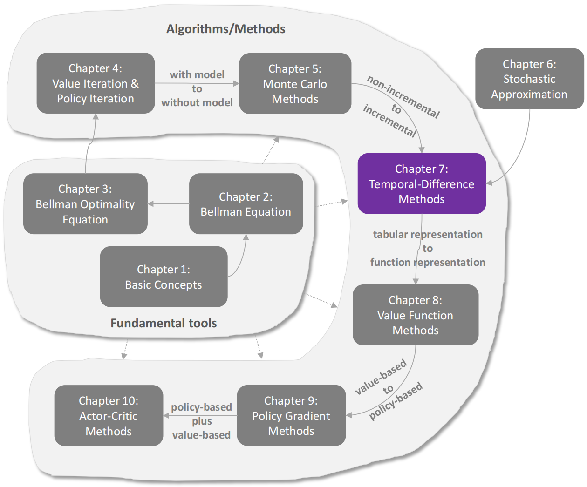

# 时序差分法

本章介绍用于强化学习的时序差分（temporal-difference，TD）方法。

与蒙特卡洛（Monte Carlo，MC）学习类似，TD 学习同样属于无模型（model-free）方法，但由于其具有**增量式**（incremental）的形式，因此具有一些优势。

有了第 6 章的准备，读者在看到 TD 学习算法时将不会感到陌生。事实上，TD 学习算法可以看作是用于求解 Bellman 方程或 Bellman 最优方程的特殊随机算法。

由于本章会介绍多个 TD 算法，因此我们首先对这些算法进行概述，并说明它们之间的关系。

1. 第 7.1 节介绍最基本的 TD 算法，它能够估计**给定策略的状态价值（state value）**。

   在学习其他 TD 算法之前，理解这一基础算法非常重要。

2. 第 7.2 节介绍 Sarsa 算法，它能够估计**给定策略的动作价值（action value）**。

   该算法可以与策略改进步骤结合，从而寻找最优策略。

   Sarsa 算法可以很容易地由第 7.1 节中的 TD 算法得到，只需要将状态价值估计替换为动作价值估计即可。

3. 第 7.3 节介绍 n-step Sarsa 算法，它是 Sarsa 算法的推广。

   后文将会说明：

   - Sarsa
   - MC 学习

   都是 n-step Sarsa 的特殊情况。

4. 第 7.4 节介绍 Q-learning 算法，它是最经典的强化学习算法之一。

   其他 TD 算法旨在求解某个给定策略对应的 Bellman 方程，而 Q-learning 则直接求解 Bellman 最优方程，以获得最优策略。

5. 第 7.5 节对本章介绍的 TD 算法进行比较，并给出统一的观点。

## 回顾基础

- 状态价值$v_\pi(s)$：$v_{\pi}(s)=\sum_{a\in\mathcal{A}}\pi(a|s)\left[\sum_{r\in\mathcal{R}}p(r|s,a)r+\gamma\sum_{s^{\prime}\in\mathcal{S}}p(s^{\prime}|s,a)v_{\pi}(s^{\prime})\right]$

- 动作价值$q_\pi(s,a)$：$\begin{aligned}q_\pi(s,a)=\sum_{r\in\mathcal{R}}p(r|s,a)r+\gamma\sum_{s^{\prime}\in\mathcal{S}}p(s^{\prime}|s,a)v_\pi(s^{\prime}).\end{aligned}$

## 状态价值的 TD 学习

TD 学习（temporal-difference learning）通常泛指一大类强化学习算法。

例如，本章中介绍的所有算法都属于 TD 学习的范畴。

然而，本节中的 “TD learning” 特指一种经典的、用于估计状态价值（state value）的算法。

### 算法描述

- 给定一个 策略$\pi$，我们的目标是对 所有状态$s\in S$ 估计其 状态价值$v_\pi(s)$。

  假设我们已经获得了一些按照 策略$\pi$ 生成的经验样本$(s_0,r_1,s_1,\dots,s_t,r_{t+1},s_{t+1},\dots)$。这里，$t$ 表示时间步（time step）。下面的 TD 算法可以利用这些样本来估计状态价值：
  $$
  v_{t+1}(s_t) = v_t(s_t) - \alpha_t(s_t) \left[ v_t(s_t) - \left( r_{t+1} + \gamma v_t(s_{t+1}) \right) \right]
  \tag{7.1}
  \label{td_value_update}
  $$
  
  $$
  v_{t+1}(s) = v_t(s), \qquad \forall s \neq s_t
  \tag{7.2}
  \label{td_state_invariance}
  $$

  其中：

  - 时间步 $t=0,1,2,\dots$

  - $v_t(s_t)$ 表示 在时间 $t$ 时，对 $v_\pi(s_t)$ 的估计；
  - $\alpha_t(s_t)$ 表示 时间 $t$ 时状态 $s_t$ 的学习率（learning rate）。
  
- 需要注意的是：

  在时间 $t$ 时，只有 被访问到的状态$s_t$ 的价值会被更新。

  对于所有 未被访问到的状态$s\neq s_t$ ，其价值保持不变，如 式$\eqref{td_state_invariance}$ 所示。

  为了简洁起见，式$\eqref{td_state_invariance}$ 经常被省略，但需要牢记这一点，因为如果没有这个式子，算法在数学上是不完整的。

### 算法推导

#### TD算法为什么是这样设计的？

> 🤔第一次接触 TD 学习算法的读者可能会疑惑，为什么它是这样设计的？
>
> 实际上，TD 学习算法可以被视为一种特殊的随机逼近算法，用于求解贝尔曼方程。

- 为了说明这一点，我们首先回顾状态价值的定义：**从当前状态开始，遵循策略 \(\pi\) 时，未来累计折扣回报的期望**
  $$
  \underbrace{
  v_{{\pi}}
  \left({s}\right)
  }_{\text{状态价值}}
  =
  {
  \mathbb{E}_{{\pi}}}
  \left[
  \underbrace{R_{t+1}}_{\text{下一时刻获得的奖励}}
  +
  \underbrace{\gamma}_{\text{折扣因子}}
  \underbrace{G_{t+1}}_{\text{从时刻 $t+1$ 开始的回报}}
  \;\middle|\;
  \underbrace{S_t}_{\text{时刻 $t$ 的状态}}
  =
  \underbrace{s}_{\text{给定的当前状态}}
  \right],
  \quad
  \underbrace{s\in\mathcal{S}}_{\text{$s$ 属于状态空间}}
  \tag{7.3}
  \label{state_value_definition}
  $$
  
  其中：
  
  - \(S_t=s\)：智能体在时刻 \(t\) 处于状态 \(s\)。
  
  - \(R_{t+1}\)：从时刻 \(t\) 的状态出发、执行动作后获得的即时奖励。
  
    \(G_{t+1}\)：从时刻 \(t+1\) 开始的未来回报。所以 \[ G_{t+1}=R_{t+2}+\gamma R_{t+3} +\gamma^2R_{t+4}+\cdots \]
  
    - 怎么理解：
  
      假设智能体经历以下过程：
      \[
      S_{t-1}\xrightarrow{R_t}S_t=s \xrightarrow{R_{t+1}}S_{t+1} \xrightarrow{R_{t+2}}\cdots
      \]
      那么：
  
      | 奖励                                            | 是否包含在 \(v_\pi(s)\) 中？ |
      | ----------------------------------------------- | ---------------------------- |
      | \(R_t\)：从上一个状态转移到当前状态时获得的奖励 | 不包含                       |
      | \(R_{t+1}\)：从当前状态出发后获得的奖励         | 包含                         |
      | \(R_{t+2},R_{t+3},\ldots\)：之后获得的奖励      | 包含，但会受到折扣           |
  
  - \(\gamma\)：折扣因子，用来降低未来奖励的权重。
  
- **根据状态价值函数的定义**，对于任意状态 \(s'\in\mathcal{S}\)，都有：
  $$
  v_\pi(s')
  =
  \mathbb{E}_\pi\left[G_{t+1}\mid S_{t+1}=s'\right]
  =
  R_{t+2}+\gamma R_{t+3} +\gamma^2R_{t+4}+\cdots
  $$

  - 其中，\(s'\) 表示一个具体的状态，\(S_{t+1}\) 表示时刻 \(t+1\) 的状态随机变量。

  - 上式的含义是：如果智能体在时刻 \(t+1\) 到达状态 \(s'\)，那么从该时刻开始，按照策略 \(\pi\) 行动所能获得的未来回报 \(G_{t+1}\) 的期望，就是状态 \(s'\) 的价值 \(v_\pi(s')\)。
  
- **接下来，考虑下一时刻可能到达不同状态的情况。**

  由于 \(S_{t+1}\) 是一个**随机变量**，因此，$S_t$的下一状态$S_{t+1}$的价值\(v_\pi(S_{t+1})\) 也是一个**随机变量**。

  根据`全期望公式`，并结合马尔可夫性质，可以得到：

  $$
  \boxed{
  \begin{aligned}
  \mathbb{E}_\pi\left[G_{t+1}\mid S_t=s\right]
  &=
  \mathbb{E}_\pi\left[
  \mathbb{E}_\pi\left[
  G_{t+1}\mid S_{t+1}
  \right]
  \middle| S_t=s
  \right]\\[6pt]
  &=
  \mathbb{E}_\pi\left[
  v_\pi(S_{t+1})\mid S_t=s
  \right].
  \end{aligned}
  }
  $$

  这里：

  - 第一步利用**全期望公式**，将未来回报的期望按照下一状态进行分解；
  - 第二步则利用**状态价值函数的定义**，将给定下一状态后的未来回报期望写成该状态的价值。

  > [!NOTE]
  >
  > - 在我们看来：
  >
  >   - 实际回报 $G_{t+1}=R_{t+2}+\gamma R_{t+3} +\gamma^2R_{t+4}+\cdots$
  >   - 状态价值 \[ v_\pi(s') = \mathbb E_\pi\left[ R_{t+2}+\gamma R_{t+3}+\gamma^2R_{t+4}+\cdots \mid S_{t+1}=s' \right]. \]
  >
  >   实际回报$G_{t+1}$ 与 状态价值$v_\pi(S_{t+1})$看上去是一样的，但是实际上只是这两者的`汇报结构`看起来一样，两者其实并不一样
  >
  > - 区别在于：
  >   - 实际回报 $G_{t+1}$ 是实际抽到的奖励序列
  >   - 状态价值 $v_\pi(S_{t+1})$ 是对所有可能奖励序列取平均后的值

- **最后，将上述等式代入状态价值函数的定义。**

  回顾式\(\eqref{state_value_definition}\)：

  $$
  v_\pi(s)
  =
  \mathbb{E}_\pi\left[
  R_{t+1}+\gamma G_{t+1}
  \mid S_t=s
  \right].
  $$

  根据期望的线性性质，将未来回报的期望替换为下一状态价值的期望，即可得到：

  $$
  \boxed{
  v_\pi(s)
  =
  \mathbb{E}_\pi\left[
  R_{t+1}+\gamma v_\pi(S_{t+1})
  \mid S_t=s
  \right],
  \qquad s\in\mathcal{S}.
  }
  \tag{7.4}
  \label{bellman_expectation}
  $$

  这就是**贝尔曼期望方程（Bellman expectation equation）**。它表明：一个状态的价值，等于当前即时奖励与下一状态价值的折扣和的期望。

> [!IMPORTANT]
>
> 在强化学习中，通常约定：
>
> - \(S_t\)：时刻 \(t\) 的**状态随机变量**，表示这个时刻可能处于哪个状态。
> - \(s\)：某个具体的状态，例如状态 A。
> - \(S_t=s\)：表示时刻 \(t\) 的状态随机变量取值为 \(s\)，也就是当前处于状态 A。

#### TD 算法的推导过程

> 接下来，我们将说明如何通过应用 Robbins–Monro 算法来求解式\(\eqref{bellman_expectation}\)，从而得到式\(\eqref{td_value_update}\)中的 TD 算法。

1. 定义一个 函数$g$ 以将`贝尔曼方程`改写成 `Robbins–Monro 算法`能处理的形式：**求一个函数的零点**。

   - `贝尔曼方程`对状态 \(s_t\) 写作：\[ v_\pi(s_t) = \mathbb E_\pi\left[ R_{t+1}+\gamma v_\pi(S_{t+1}) \mid S_t=s_t \right]. \]

     把右边移到左边，方程成立时两边之差应为零。于是定义\[ g\left(v_\pi(s_t)\right) = v_\pi(s_t) - \mathbb E_\pi\left[ R_{t+1}+\gamma v_\pi(S_{t+1}) \mid S_t=s_t \right], \]

     贝尔曼方程就等价于\[ g\left(v_\pi(s_t)\right)=0. \]

2. **我们的目标是求解上述方程，从而通过 Robbins–Monro 算法得到状态 \(s_t\) 的价值 \(v_\pi(s_t)\)**

   - 由于我们可以获得 \(r_{t+1}\) 和 \(s_{t+1}\)，它们分别是随机变量 \(R_{t+1}\) 和 \(S_{t+1}\) 的样本，因此，我们能够获得的 \(g(v_\pi(s_t))\) 的带噪观测值为：
     $$
     \begin{aligned} \tilde{g}\left(v_\pi(s_t)\right) &= v_\pi(s_t) - \left[ r_{t+1}+\gamma v_\pi(s_{t+1}) \right]\\[6pt] &= \underbrace{ \left\{ v_\pi(s_t) - \mathbb{E}_\pi \left[ R_{t+1}+\gamma v_\pi(S_{t+1}) \mid S_t=s_t \right] \right\} }_{g(v_\pi(s_t))} \\[6pt] &\quad+ \underbrace{ \left\{ \mathbb{E}_\pi \left[ R_{t+1}+\gamma v_\pi(S_{t+1}) \mid S_t=s_t \right] - \left[ r_{t+1}+\gamma v_\pi(s_{t+1}) \right] \right\} }_{\eta_t}. \end{aligned}
     $$
     其中：

     - \(\eta_t\) 定义为 **带噪观测值\(\tilde g\)** 与 **理想值\(g\)** 之间的差：\[ \eta_t \equiv \tilde g(v_\pi(s_t))-g(v_\pi(s_t)). \]

   - 因此，根据 Robbins–Monro 的 **随机求根更新算法**，

     为了求解方程 \(g(v_\pi(s_t))=0\)，我们可以采用如下更新规则：如果要找 \(g(x)=0\) 的根，就从当前猜测 \(x_t\) 出发，根据一次带噪观测 \(\tilde g(x_t)\) 调整它：
     $$
     x_{t+1}=x_t-\alpha_t\tilde g(x_t).
     $$
     这儿要找的根是状态 \(s_t\) 的真实价值 \(v_\pi(s_t)\)，所以把当前猜测 \(x_t\) 换成它的估计 \(v_t(s_t)\)：
     \[
     v_{t+1}(s_t) = v_t(s_t)-\alpha_t(s_t)\tilde g\bigl(v_t(s_t)\bigr).
     \]
     再把带噪观测的形式代入，就得到：
     $$
     \begin{aligned} v_{t+1}(s_t) &= v_t(s_t) - \alpha_t(s_t) \tilde{g}\left(v_t(s_t)\right)\\[6pt] &= v_t(s_t) - \alpha_t(s_t) \left\{ v_t(s_t) - \left[ r_{t+1}+\gamma v_\pi(s_{t+1}) \right] \right\}. \end{aligned} \tag{7.5}\label{robbins_monro_update}
     $$
     其中：

     - \(v_t(s_t)\) 表示在时间步 \(t\) 对状态 \(s_t\) 的价值 \(v_\pi(s_t)\) 的估计
     - \(\alpha_t(s_t)\) 表示相应的学习率。

     式\(\eqref{robbins_monro_update}\)的形式与式\(\eqref{td_value_update}\)中的 TD 算法非常相似。**二者唯一的区别在于：式\(\eqref{robbins_monro_update}\)右侧使用的是 \(v_\pi(s_{t+1})\)，而式\(\eqref{td_value_update}\)使用的是 \(v_t(s_{t+1})\)。**

     这是因为，式\(\eqref{robbins_monro_update}\)是在假设其他状态的价值都已经已知的情况下，专门用于估计状态 \(s_t\) 的价值的。

     但是，如果我们希望估计所有状态的价值，就需要将式\(\eqref{robbins_monro_update}\)右侧的 \(v_\pi(s_{t+1})\) 替换为 \(v_t(s_{t+1})\)。这样一来，式\(\eqref{robbins_monro_update}\)就与式\(\eqref{td_value_update}\)完全一致了。

     然而，这样的替换是否仍然能够保证算法收敛呢？

     答案是肯定的，相关证明将在后面的定理 7.1 中给出。

#### 性质分析

现在我们研究 TD算法 的一些重要性质。

观察 式$\eqref{td_value_update}$ ，我们给该式加上一些注释：
\[
\underbrace{v_{t+1}(s_t)}_{\text{新估计值}}
=
\underbrace{v_t(s_t)}_{\text{当前估计值}}
-\alpha_t(s_t)
\left[
\overbrace{
v_t(s_t)-\underbrace{\left(r_{t+1}+\gamma v_t(s_{t+1})\right)}_{\text{TD 目标}\bar{v}_t}
}^{\text{TD 误差 }\delta_t}
\right]
\tag{7.6}
\]
其中：

- $\bar v_t\triangleq r_{t+1}+\gamma v_t(s_{t+1})$ 称为 **TD 目标（TD target）**

- $\delta_t\triangleq v_t(s_t)-\bar v_t
  =v_t(s_t)-\left(r_{t+1}+\gamma v_t(s_{t+1})\right)$ 称为 **TD 误差（TD error）**

  因此，新的估计 \(v_{t+1}(s_t)\) 是当前估计 \(v_t(s_t)\) 与 TD 误差共同决定的。

##### 怎么理解 TD目标 \(\bar v_t\)

因为算法试图推动 \(v_t(s_t)\) 向目标值 \(\bar v_t\) 靠近。将式 (7.6) 两侧同时减去 \(\bar v_t\)，可得

$$
\begin{aligned}
v_{t+1}(s_t)-\bar v_t
&=v_t(s_t)-\bar v_t-\alpha_t(s_t)[v_t(s_t)-\bar v_t]\\
&=[1-\alpha_t(s_t)][v_t(s_t)-\bar v_t].
\end{aligned}
$$

两侧取绝对值：

$$
|v_{t+1}(s_t)-\bar v_t|=|1-\alpha_t(s_t)|\,|v_t(s_t)-\bar v_t|.
$$

由于 \(\alpha_t(s_t)\) 是较小的正数，因此 \(0<1-\alpha_t(s_t)<1\)，于是

$$
|v_{t+1}(s_t)-\bar v_t|<|v_t(s_t)-\bar v_t|.
$$

**这个不等式说明，新值 \(v_{t+1}(s_t)\) 比旧值 \(v_t(s_t)\) 更接近 \(\bar v_t\)。因此，从数学上说，算法会推动 \(v_t(s_t)\) 朝 \(\bar v_t\) 移动，这就是 \(\bar v_t\) 被称为 TD 目标的原因。**

##### 怎么理解 TD 误差 $\delta_t$

1. `时序差分（TD）`的`差分`指的是：把当前时刻的价值估计，与“这一步实际得到的奖励加上下一时刻的价值估计”作比较：
   $$
   \delta_t=v_t(s_t)-\left(r_{t+1}+\gamma v_t(s_{t+1})\right)
   $$

   它比较的是相邻两个时刻的信息：时刻 $t$ 的估计 $v_t(s_t)$，以及由时刻 $t+1$ 的奖励和价值估计组成的目标。这个差值根据一次经验样本计算，因此每次经历都可能不同。

   如果估计已经准确，也就是 $v_t=v_\pi$，那么在同一个状态 $s_t$ 上反复采样时，TD 误差的平均值为零：

   $$
   \begin{aligned}
   \mathbb E[\delta_t\mid S_t=s_t]
   &=v_\pi(s_t)-\mathbb E_\pi\left[R_{t+1}+\gamma v_\pi(S_{t+1})\mid S_t=s_t\right]\\
   &=0.
   \end{aligned}
   $$

   这是因为贝尔曼期望方程说明，真实价值 $v_\pi(s_t)$ 正好等于下一步奖励与折扣后下一状态价值的条件期望，所以两者相减为零（见式\(\eqref{bellman_expectation}\)）。

   “平均值为零”不代表每次采样的 TD 误差都是零。一次经历可能得到较高或较低的奖励，也可能到达不同的下一状态，因此误差会暂时为正或为负。若当前估计还不准确，这些误差就能帮助算法调整估计。

   从估计的角度看，TD 误差也称为**创新量（innovation）**：它表示这次新观察到的经验与当前估计所预期结果之间的差异。TD 学习利用这份新信息更新价值估计。类似的“新观察减去原先预期”的想法，也出现在卡尔曼滤波等估计方法中 [33, 34]。

   最后，本节的 TD 算法用于估计**给定策略** $\pi$ 的状态价值 $v_\pi$。如果目标是找到最优策略，还需要估计动作价值并进行策略改进；第 7.2 节会介绍相关方法。本节的状态价值 TD 学习是理解后续算法的基础。

2. 公式（7.1）中的 TD 算法只能估计给定策略的状态价值。为了找到最优策略，我们还需要进一步计算动作价值，然后进行策略改进。这部分内容将在第 7.2 节中介绍。尽管如此，本节介绍的 TD 算法仍然是一个非常基础且重要的算法，有助于理解本章中的其他算法。

3. 虽然 TD 学习和蒙特卡洛（MC）学习都属于无模型（model-free）方法，但它们各自有哪些优点和缺点呢？

   | 比较维度 | TD 学习（TD Learning） | 蒙特卡洛学习（MC Learning） |
   | ----------------------------------- | ------------------------------------------------------------ | ------------------------------------------------------------ |
   | **增量性（Incremental）** | TD 学习是一种**增量式学习方法**。每当获得一个经验样本后，就可以立即更新状态价值或动作价值。 | MC 学习是一种**非增量式学习方法**。它必须等待一个完整的幕（episode）采集完毕后才能进行更新，因为它需要计算整个幕的折扣回报。 |
   | **适用任务（Tasks）** | **持续性任务（Continuing tasks）：** 由于 TD 学习具有增量性，因此既可以处理幕式任务，也可以处理持续性任务。持续性任务可能不存在终止状态。 | **幕式任务（Episodic tasks）：** 由于 MC 学习是非增量式的，因此只能处理幕式任务，即任务会在有限步数后终止。 |
   | **自举机制（Bootstrapping）** | TD 学习采用**自举机制**，因为状态价值或动作价值的更新依赖于该价值的先前估计。因此，TD 学习需要预先给出一个初始价值估计。 | **非自举（Non-bootstrapping）：** MC 学习不采用自举机制，因为它可以直接估计状态价值或动作价值，而不需要预先给出初始价值估计。 |
   | **估计方差（Estimation Variance）** | **估计方差较低（Low estimation variance）：** TD 学习的估计方差低于 MC 学习，因为它涉及的随机变量较少。例如，为了估计动作价值 $q_\pi(s_t,a_t)$，Sarsa 只需要涉及以下三个随机变量的样本：$R_{t+1}$、$S_{t+1}$ 和 $A_{t+1}$。 | **估计方差较高（High estimation variance）：** MC 学习涉及的随机变量较多，因此估计方差更高。例如，为了估计 $q_\pi(s_t,a_t)$，需要对以下回报进行采样：$\displaystyle R_{t+1}+\gamma R_{t+2}+\gamma^2R_{t+3}+\cdots$。假设每个幕的长度为 $L$，并且每个状态拥有相同数量的动作，即 $\lvert\mathcal{A}\rvert$，那么在一个软策略（soft policy）下，可能存在的幕数量为 $\lvert\mathcal{A}\rvert^L$。如果仅使用少量幕进行估计，那么估计方差较高也就不足为奇了。 |

   **注：** 表中的 TD 指时序差分（Temporal-Difference），MC 指蒙特卡洛（Monte Carlo）。$\gamma$ 为折扣因子，$R_{t+1}$ 为下一时刻获得的奖励，$S_{t+1}$ 为下一时刻的状态，$A_{t+1}$ 为下一时刻选择的动作。

### 收敛性分析

**定理 7.1（TD 学习的收敛性）。** 给定策略 \(\pi\)，若对所有 \(s\in\mathcal S\)，学习率满足
$$
\sum_t\alpha_t(s)=\infty,\qquad \sum_t\alpha_t^2(s)<\infty,
$$

则根据式 (7.1) 的 TD 算法，当 \(t\to\infty\) 时，对所有 \(s\in\mathcal S\)，\(v_t(s)\) 几乎必然收敛到 \(v_\pi(s)\)。

这两个学习率条件可以这样理解。对于某个固定状态 \(s\)，只在访问到它时才更新它的价值；没有访问时，令 \(\alpha_t(s)=0\)。因此，求和是把训练过程中针对状态 \(s\) 的所有更新步长加起来。

- 条件 \(\sum_t\alpha_t(s)=\infty\) 表示累计更新量不能太小。若某状态只被访问有限次，这个和就只有有限项，条件无法满足；所以每个要估计的状态都必须被访问无限多次。
- 条件 \(\sum_t\alpha_t^2(s)<\infty\) 表示步长要逐渐变小，使后期采样噪声对估计的影响逐渐减弱。

例如，若状态 \(s\) 第 \(n\) 次被访问时使用步长 \(\alpha_n(s)=1/n\)，则步长之和发散，而平方和收敛，满足这两个条件。注意这里的 \(n\) 是状态 \(s\) 被访问的次数，不一定等于全局时间步 \(t\)。

这也说明了探索的作用：学习率条件本身不能让状态自动出现；采样过程必须让每个需要估值的状态都反复出现。对于固定策略的状态价值估计，应保证每个相关状态被无限次访问。`探索性初始状态`或`探索性策略`可以帮助达到这一点，但只能覆盖在该设定下确实可能到达的状态。动作价值控制问题中，通常还要保证相关状态-动作对得到足够访问。

实践中有时使用固定的小学习率 \(\alpha\)。这样每次更新都保留一定幅度，因而平方步长之和会发散，不满足上述定理的条件；在持续有采样噪声时，估计通常会在真实值附近波动，而非保证逐次收敛到真实值。固定步长可能在某些额外假设下有期望或稳态误差方面的结论，但不能仅凭本定理推出“收敛到 \(v_\pi\)”。

## 动作价值的 TD 学习：Sarsa

第 7.1 节介绍的 TD 算法只能估计**状态价值**。本节将介绍另一种 TD 算法，称为 **Sarsa**，它可以直接估计**动作价值**。

估计动作价值非常重要，因为它可以与策略改进步骤相结合，从而学习最优策略。

### 算法描述

给定一个策略 $\pi$，我们的目标是估计动作价值。

假设我们已经获得了一些按照策略 $\pi$ 生成的经验样本：
$$
(s_0,a_0,r_1,s_1,a_1,\ldots,s_t,a_t,r_{t+1},s_{t+1},a_{t+1},\ldots)
$$
我们可以使用下面的 **Sarsa 算法**来估计动作价值：
\[
\underbrace{q_{t+1}(s_t,a_t)}_{\text{更新后的动作价值估计}}=\underbrace{q_t(s_t,a_t)}_{\text{当前动作价值估计}}-\underbrace{\alpha_t(s_t,a_t)}_{\text{学习率}}\left[\underbrace{q_t(s_t,a_t)}_{\text{当前动作价值估计}}-\left(\underbrace{r_{t+1}}_{\text{即时奖励}}+\underbrace{\gamma}_{\text{折扣因子}}\underbrace{q_t(s_{t+1},a_{t+1})}_{\text{下一状态—动作价值估计}}\right)\right]
\tag{7.12}
\]
对于所有满足 $(s,a)\neq(s_t,a_t)$ 的**状态—动作对**，有
$$
q_{t+1}(s,a)=q_t(s,a).
$$
其中，$t=0,1,2,\ldots$，且 $\alpha_t(s_t,a_t)$ 为学习率。

这里，(q_t(s_t,a_t)) 是对 (q_\pi(s_t,a_t)) 的估计。

在时刻 (t)，只有状态—动作对 ((s_t,a_t)) 所对应的 (q) 值会被更新，其他状态—动作对的 (q) 值保持不变。

下面讨论 Sarsa 算法的一些重要性质。

### 1. 为什么这个算法被称为 Sarsa？

这是因为算法的每次迭代都需要使用以下五个元素：
$$
(s_t,a_t,r_{t+1},s_{t+1},a_{t+1}).
$$
Sarsa 是 **State-Action-Reward-State-Action** 的缩写，即：

- State：状态；
- Action：动作；
- Reward：奖励；
- State：下一状态；
- Action：下一动作。

Sarsa 算法最初由文献 [35] 提出，其名称则由文献 [3] 确定。

#### 2. 为什么 Sarsa 要这样设计？

你可能已经注意到，Sarsa 与公式 (7.1) 中的 TD 算法非常相似。

事实上，只需要将 TD 算法中的**状态价值估计替换为动作价值估计**，就可以很容易地得到 Sarsa 算法。

#### 3. 从数学上看，Sarsa 做了什么？

与公式 (7.1) 中的 TD 算法类似，Sarsa 是一种**随机逼近算法**，用于求解给定策略的贝尔曼方程：

\mathbb{E}\left[
R+\gamma q_\pi(S',A')
\mid s,a
\right],
\qquad \forall (s,a).
\tag{7.13}
$$

公式 (7.13) 是用**动作价值**表示的贝尔曼方程。

相关证明见方框 7.3。

